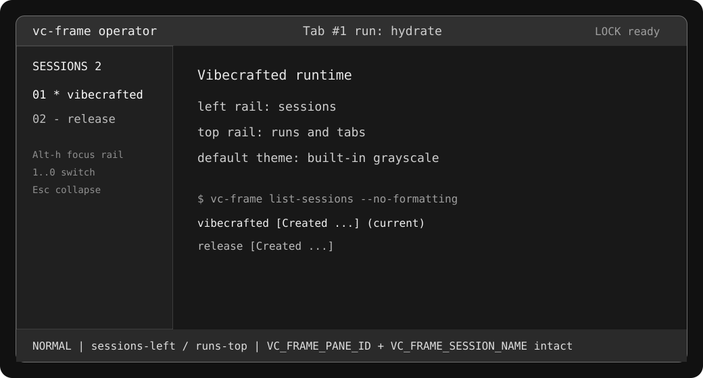

# vc-frame Operator Surface

vc-frame is the Vetcoders terminal frame for Vibecrafted operator work. It is a
Zellij-core fork with a fork-owned default surface: grayscale chrome, sessions on
the left, and runs/tabs on top.



## Product Promise

Fresh `vc-frame` starts with no theme configured should make the operator state
obvious before any command is typed:

- sessions are listed in the left rail
- runs and tabs stay in the top bar
- ordinary frame chrome is grayscale by default
- color is reserved for state that needs attention
- Vibecrafted fleet liveness output remains machine-parseable

## Default Layout

The default layout uses the existing plugins rather than a new parallel session
system:

- `tab-bar` renders the top run/tab rail
- `session-manager` renders the left rail with `rail true`
- the main pane starts to the right of the 24-column rail
- `status-bar` stays at the bottom

The `session-rail` plugin alias in `zellij-utils/assets/config/default.kdl`
points at `zellij:session-manager` with `rail true`.

The operator entrypoint layout (`vibecrafted`) replaces the top `tab-bar` with
the redesigned `compact-bar`: brand chip, inverted mode chip, fisheye tab
ribbons, the Quick cmd chip (`Shift+Cmd+.`), and the Command Composer chip (`Cmd+E`). Zones
follow the Fixed Character Grid Model — brand 14 cols, mode 5 cols, toolbar
54 cols — so mode switches never shift the tab zone. `left_inset` (default **6**
at standard monospace; raise to 9–12 for large fonts) clears the macOS traffic
lights in a decoration-free host window. Quick cmd floats a login shell in the lower part of
the current tab; Composer drafts via `$VC_COMPOSER`/`$EDITOR`, seeds from and
pushes to the Paste Stack (`~/.cache/vc-frame/paste-stack.json`), then
`write-chars` into the pane beneath (Enter stays human). Inside the Composer,
`?` (normal mode) toggles a built-in cheat sheet — `q`/`Esc` closes it;
backward-search is deliberately traded away, `/` still searches. The bottom
`status-bar` owns pure status: the fleet `LIVE` count, host CPU/memory/disk
cockpit (fixed-width fields), health, and layout state.

Click **Aa**, immediately right of the moon/sun control, to open Terminal
Typography from the existing Agents onboarding chooser. Repeated clicks focus
the live chooser in the current tab. Opening it does not select a font or start
an agent; selection is explicit in the chooser. At narrow widths Aa disappears
first, leaving the existing theme and tool hit regions intact.

Frame invokes the Agents-owned `vc-agent-workshop.py launcher --font` through
`pane-python` under `VC_FRAME_CONFIG_DIR`, falling back to
`${XDG_CONFIG_HOME:-$HOME/.config}/vibecrafted/vc-frame` and the canonical
`VIBECRAFTED_PYTHON`/executable-script conventions. A missing launcher leaves a
visible diagnostic. The chooser and font policy stay owned by Vibecrafted.

Quick cmd, Composer, Panels, and explicit mode help share the compact-bar's
context layer. Opening a tool hides its peers without closing their processes
or drafts; server pane updates reconcile keyboard opens and selection from
Panels. Automatic mode hints wait while another tool is visible. This policy
is scoped to the current tab and does not hide ordinary work panes or Voc.
Panels projects the server's `PaneManifest`: user agent terminals, work shells
(including Quick cmd), and Launchpad. Known Voc, Agent Workspaces and Composer
form invocations and infrastructure plugins are excluded; a user shell's title
does not turn it into a utility. Suppressed user panes stay discoverable.
Server admission and cleanup distinguish these configured tool roles from the
ordinary compact-bar singleton; drawers have a separate identity per tab and
never inherit session-canvas authority.

Panels shows a flat, paged list of titles. Use Up/Down (or j/k) and Enter to
focus a panel, `d` to expand/fold the selected panel's details, and Esc to close
the drawer. Every toolbar Panels click opens and focuses the existing drawer;
its native top-right `x` hides only the drawer, without pinning or closing
work panes. The selection follows pane identity across inventory refreshes.
Long titles use an explicit ellipsis; expanded details wrap within the pane.
Quick cmd sits below the upper content region. Panels uses a narrow right-edge
drawer (24% of display columns) at full content height, including after resize. These placements are not a general occlusion solver for
arbitrarily positioned user panes. VOC's internal dialogs and empty-workspace
onboarding are owned by the sibling Vibecrafted dashboard.

The diodes live in the resting mode only (LOCK when the base mode is locked,
NORMAL otherwise) — action modes hand every column to the shortcut hints and
keep just the swap-layout chip as arrangement context. On a narrow bar the
segment degrades block by block (DISK, then MEM, then CPU, then the swap
chip, then HEALTH; the fleet pulse goes last) instead of vanishing whole,
and a two-cell seam always separates hints from statuses.

`LIVE` has a bounded background-cost contract. The server derives the count
once from the session snapshot it already owns and sends a small scalar message
only to the status-bar plugin/client pairs viewing active tabs. When a client
switches tabs, the server sends an exact plugin/client deactivation signal to
the status bar it left; sampling does not rely on the tab-global `Visible`
event, which cannot distinguish multiple clients in one session. A client that
detaches is covered by the same transition: the chrome it had visible is parked
as the client leaves, so a server with nobody attached holds no chrome that
keeps polling for cross-session state. Attaching re-activates that chrome
through the ordinary active-target path, and the session list it shows is
rebuilt on the spot. Per-tab
status bars never subscribe to the full cross-session `SessionUpdate`, and
unrelated `CustomMessage` consumers are not awakened. Host resource sampling
also runs only in active status-bar instances, and clipboard timers cannot
create extra sampling cadences. These lifecycle messages describe refreshable
current state, so they bypass the shared pending-plugin event cache: an already
ready exact target receives them immediately even while another client instance
is loading. A not-yet-ready status bar starts idle and requests a fresh server
snapshot after it loads successfully. A failed or disconnected attach therefore
cannot leave a cached lifecycle signal blocking healthy status-bar instances.
The lifecycle recognizer covers the canonical `vc-frame:status-bar`, the legacy
`zellij:status-bar`, the default `status-bar` alias, and renamed aliases that
resolve to that built-in plugin. An unrelated `file:` or remote plugin is not
treated as the built-in status bar merely because its filename looks similar;
custom replacements must implement and wire their own sampling lifecycle.

## Session Socket Ownership

A session name maps to one socket file, and exactly one live server may own it.
A starting server probes that path before binding: if a process is listening
there — even one too busy to answer a health probe — the newcomer refuses to
start and says so in the log instead of unlinking the file and binding over it.
Only a path that nothing is listening on (missing, stale after a crash, or not
a socket at all) is cleaned up and re-bound.

The rule exists because stealing a socket does not stop the previous server: it
keeps running, unreachable, with zero clients, and nothing ever reaps it. A
server that already runs a session also rejects a second new-session request
rather than re-initializing over live state; the caller sees the refusal and
can attach to the existing session instead.

The probe is a Unix-only mechanism, because only there is the session path a
socket that a second server can unlink and rebind. Off Unix the path is a
marker file and the listener is a named pipe whose name the OS refuses to hand
out twice, so the bind itself already decides ownership — the marker is written
only after it succeeds.

### Project Admission

Project opening uses the selected RuntimePack's public `bin/vc-frame` wrapper
and verifies the running native engine against that same physical generation's
`libexec/vc-frame` (`bin/vc-frame.cmd` and `libexec/vc-frame.exe` on Windows).
The canonical Vibecrafted owner publishes exact selected layout and companion
swap bytes under the approved writable `VC_FRAME_CONFIG_DIR/layouts`, within
its create lock; startup does not modify the immutable RuntimePack. Reusing a
seat preserves its existing layout and workloads. A picked folder requests
automatic naming, leaving sanitization and collisions with that owner; explicit
user names retain strict validation.

Guarded attachment checks the immutable server lifetime before forwarding an
attach that can change configuration, geometry or membership. It does not wait
for Screen to drain its query queue. The browser keeps the accepted connection
when switching sessions and retains `expected_session_incarnation` in its URL
for refresh and reconnection, so a same-name replacement cannot gain an
unguarded connection.

The Darwin production-shaped regression uses the canonical runtime installer
and resolver in a disposable private runtime home, with the real product
wrapper, a physical native engine, pinned portable Python and writable product
config. It carries native dependencies from the existing installed generation
as read-only donors and records their identities separately from the selected
source revisions. It skips foundations installation in this private fixture.
Pass clean candidate and Vibecrafted source paths:

```bash
python3 zellij-server/tests/rail_project_owner_pty.py \
  --binary /path/to/candidate/vc-frame \
  --runtime-root /path/to/clean/vibecrafted \
  --output /path/to/new/receipt-directory --installed
```

This fixture seals the private generation against startup writes and does not
install or launch the user's desktop app. Its receipt is runtime acceptance
evidence, not a signed, notarized or live installation claim.

Ordinary and long project names exercise the actual Strider picker. A POSIX
backslash basename's automatic naming is checked directly through `prepare-project`;
the picker display for that basename is outside this naming assertion.
Guarded browser rejection compares membership, pane geometry and workload identity,
not cursor coordinates which startup programs can change independently.
Headless Chromium uses a private profile and noninteractive test keychain; its
test-only sandbox flags do not change the shipped browser or native admission.

## Key Contract

The shipped defaults promise one navigation language — one modifier per
owner (contract v3):

- `Cmd+←/→` — previous/next tab, **every mode including LOCK**
- `Cmd+↑/↓` — previous/next session, **every mode including LOCK**
- `Shift+Cmd+.` / `Super+Shift+.` — Quick cmd mini-console, **every mode including LOCK**
- `Cmd+E` / `Super+e` — Command Composer (sole product key; **not** Alt+e —
  Alt+e types Polish `ę` on macOS)
- `Ctrl+s` then `v` — mouseless scrollback selection (read-only vim; `y`
  copies to clipboard + Paste Stack)
- `Ctrl+arrows` — the same switcher outside LOCK; inside LOCK they pass
  through to the pane (the shell owns Ctrl there)
- `Alt` — belongs entirely to the writer: diacritics layer and host-side
  word-jump; vc-frame binds no Alt+arrow keys

If declared keys do nothing, the usual culprit is a frozen
`keybinds clear-defaults=true` dump in the user config shadowing the shipped
contract. `vc-frame doctor` diagnoses it (read-only, `--json`, exit 0/1/2) and
`vc-frame repair key-bindings` fixes it with a backup and an explicit report
of any personal binds lost. Full runbook: [DOCTOR.md](DOCTOR.md). Host-side
requirements (macOS `option_as_alt`, hints, glyph width) live in
[ALACRITTY_INTEGRATION.md](ALACRITTY_INTEGRATION.md).

## Try It From Source

```bash
make install
vc-frame setup --check
vc-frame setup --dump-layout default
vc-frame setup --dump-config
vc-frame
```

Public packages and executables named `zellij` belong to upstream Zellij, not
the Vetcoders vc-frame runtime.

## Release Channel & Vibecrafted Mutualism

The release-grade path is documented in [RELEASE.md](RELEASE.md). Standalone
public releases provide prebuilt multi-platform `vc-frame-*` archives and
Windows MSI packages, checksums, GPG signatures, `manifest.json`, and a served
installer:

```bash
VCFRAME_GPG_FINGERPRINT=<pinned-fingerprint> \
  sh -c "$(curl -fsSL https://github.com/vetcoders/vc-frame/releases/latest/download/install.sh)"
vc-frame --version
```

In mutualism with `Vibecrafted.app`, `vc-frame` also exposes `make release` and
`make release-binary` so the desktop bundle (`Vibecrafted.dmg` from
`vetcoders/vibecrafted`) can embed a provenance-stable `vc-frame` binary without
locking standalone CLI users into the full desktop bundle.

## Verified Runtime Evidence

The July 2026 lifecycle verified the default surface against the real debug
binary:

- `cargo check --workspace` passed
- `cargo test --workspace` passed in polarize/DoU
- `make clippy` passed as the repo-native lint gate
- `setup --dump-layout default` showed the left rail plus top `tab-bar`
- live PTY marbles runs rendered `SESSIONS 2` with `Tab #1`
- rail ordinal switching moved a client between live sessions
- locked mode kept the `Sessions` rail visible and unsuppressed
- `list-sessions --no-formatting` preserved `[Created ...]` rows and `(current)`

The canonical gate now runs
`cargo clippy --workspace --all-targets --all-features -- -D warnings` and is
green without gate-wide allowances. Legacy positional test adapters carry only
documented per-site exceptions while production paths remain fully strict.

## Upstream Boundary

vc-frame intentionally keeps Zellij compatibility for configuration, layouts,
plugins, and many docs concepts. Upstream documentation is useful for inherited
features, but vc-frame-specific claims live in this repository:

- default grayscale styling
- left session rail
- top run/tab rail
- Vibecrafted layout installation
- `VC_FRAME_*` env contracts
- release installer and artifact names
